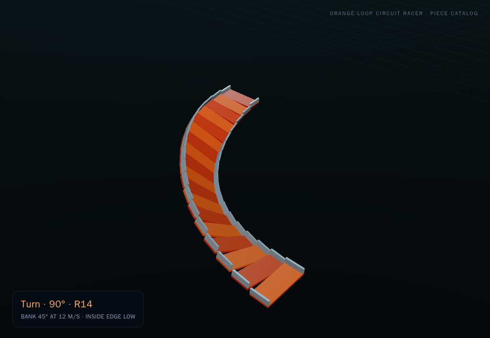
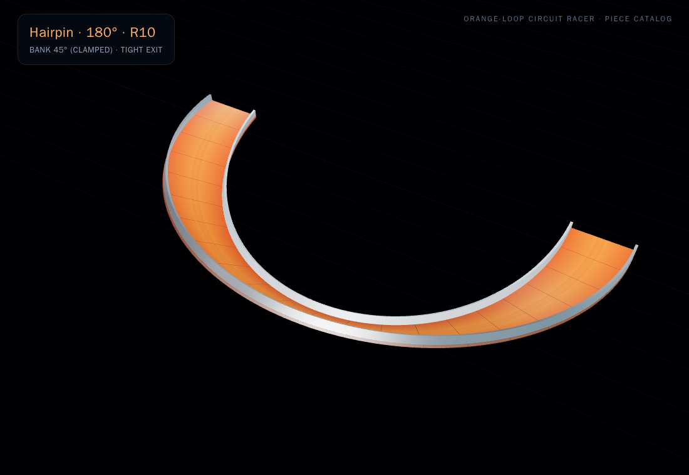
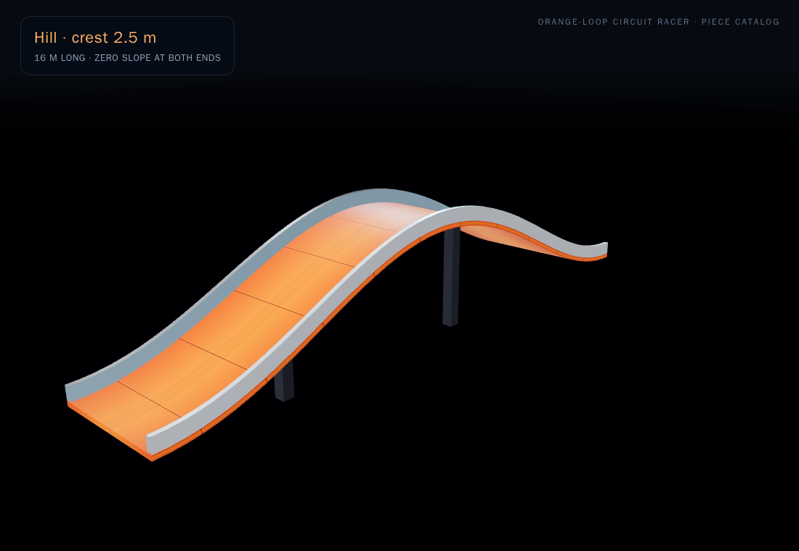
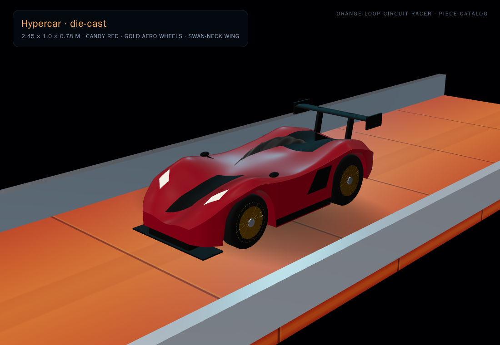

# Asset catalog

Rendered references for every gameplay asset. These images are documentation and
design review material, not files loaded at runtime: the game builds all geometry
and textures procedurally, and still downloads no models, textures, or fonts.

Regenerate the whole catalog with:

```bash
npm run assets                 # all assets
npm run assets -- car car-side cockpit  # only the named ones
```

Rendering is deterministic: `tools/preview/` rebuilds each asset from the same
parametric definitions the game uses, in headless Chromium with three.js.

## Track pieces

| Piece | Image | Geometry | Notes |
| --- | --- | --- | --- |
| Straight |  | 12 m, flat | Joins both ends at zero slope |
| Bend |  | 45°, R18 | Bank ~39° at 12 m/s |
| Turn |  | 90°, R14 | Bank ~45° at 12 m/s |
| Hairpin |  | 180°, R10 | Bank clamped at 45° |
| Loop |  | R7 vertical, 360° | Ring lifted 0.8 m on 3.4 m entry and exit ramps; ends 6.8 m apart |
| Hill |  | 16 m, crest 2.5 m | Zero slope at both ends |
| Boost straight |  | 12 m + armed strip | Chevrons face the driving direction |

All pieces are 3.0 m wide (three car widths), 0.12 m thick, with 0.35 m guide
rails, and start and end unbanked so any two pieces join cleanly.

## Car




Die-cast hypercar, 2.45 × 1.0 × 0.78 m, 1.4 m wheelbase, roof 0.71 m. The shell
is lofted from longitudinal cross-sections, and each section carries a full
profile - floor, arch line, shoulder, fender crown, centreline - so the body
wraps the wheels instead of leaving them exposed. Wheel arches are circles
concentric with each tyre plus a 30 mm gap, which is what keeps the bodywork
out of the wheels. Details are sampled from that same surface: a lofted black
canopy, a tapered hood blade, side intakes, sills, a wide-mouth nose, diffuser
fins, a tail light bar, and a swan-neck rear wing on uprights with endplates.
Wheels are lathed tyres with gold multi-spoke faces. Candy red paint, black
aero, and gold rims come from `src/game/car-model.mjs`, which the game and this
render both use, so the catalog image is always the car you drive.

## Cockpit


Driver's-eye view: a generated dashboard texture (speed, damage, lap, timer) on a
single plane, a simple steering wheel, and the hood. No modelled interior, no
downloaded art. In the game the rig is attached to the cockpit camera, and the
exterior shell is hidden to keep the view clear.

## Adding a piece

1. Add a path function and an entry in `PIECES` in `tools/preview/preview.mjs`.
2. Add the piece to `PIECES` in `tools/render-assets.mjs`.
3. Run `npm run assets`.
4. Copy the render into this table and update `openspec/specs/game/spec.md` for
   the new geometry.

## Track models

Each track piece is also exported as a self-contained binary glTF (`.glb`) with
embedded textures:

```bash
npm run assets:glb
```

The files live next to the previews in `assets/track/` and use the same
parametric definitions, so models and images cannot drift apart. The car and
cockpit are not exported yet; they will follow the same format once the car
model is final.
