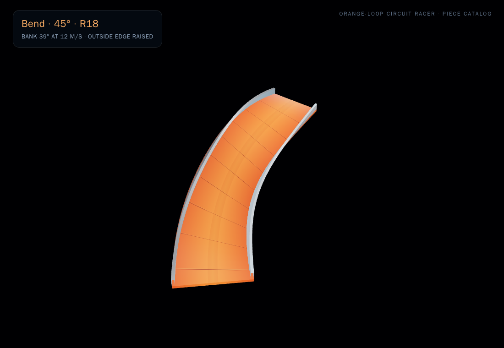
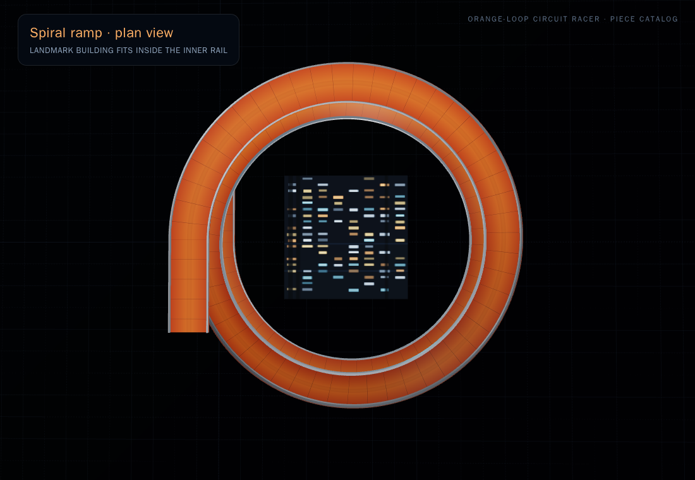
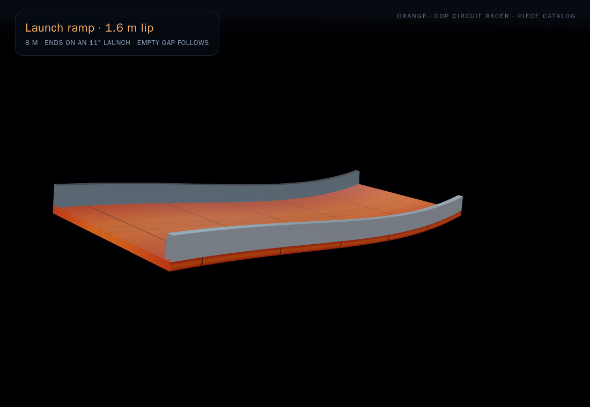
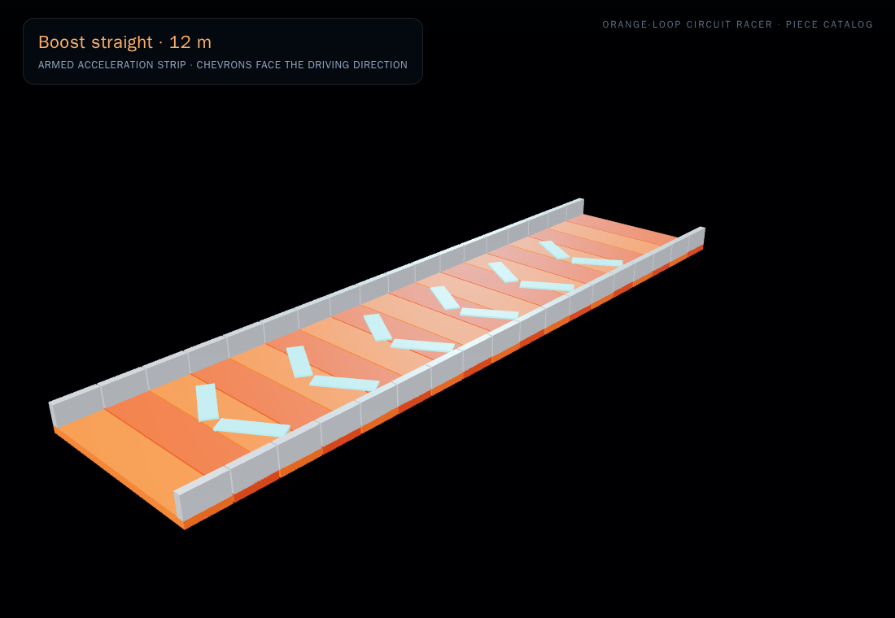
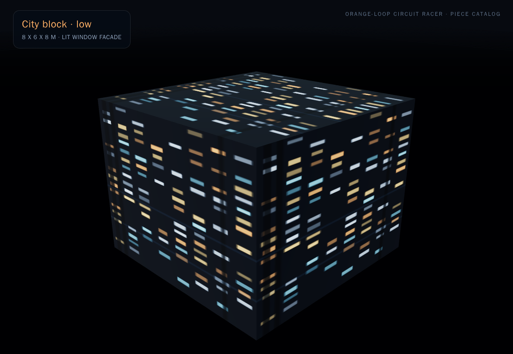
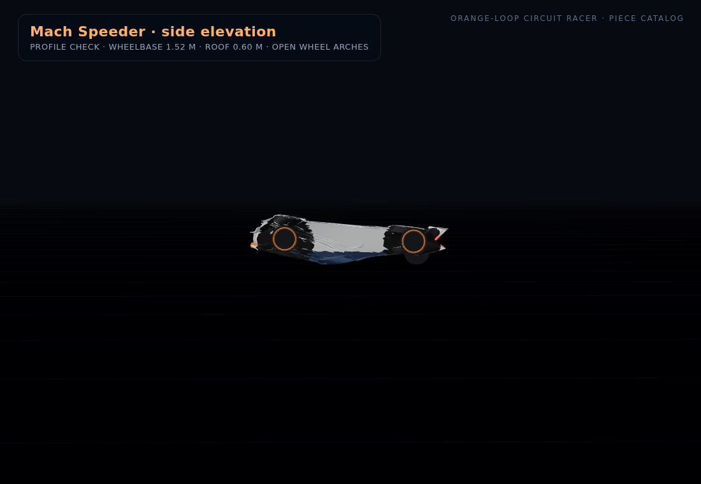
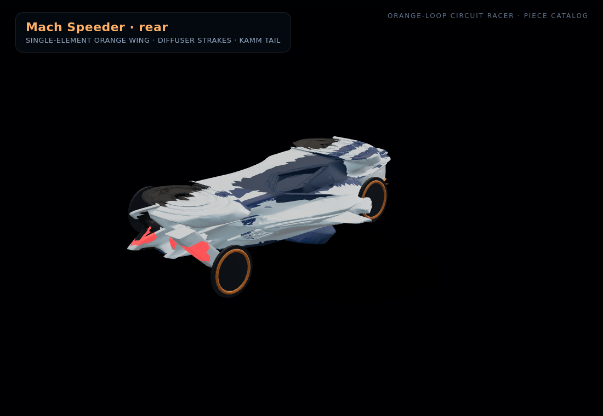

# Asset catalog

Rendered references for every gameplay asset. Track, city, and cockpit geometry
is still generated procedurally at runtime; the car is the one authored model and
the game loads its GLB from `public/models/car.glb`.

Regenerate the whole catalog with:

```bash
npm run assets                 # all assets
npm run assets -- car car-side cockpit  # only the named ones
```

Rendering is deterministic: `tools/preview/` rebuilds each asset from the same
parametric definitions the game uses, in headless Chromium with three.js.

## Track pieces

| Piece | Image | Geometry | Notes |
| --- | --- | --- | --- |
| Straight |  | 12 m, flat | Joins both ends at zero slope |
| Bend |  | 45°, R18 | Bank ~39° at 12 m/s |
| Turn |  | 90°, R14 | Bank ~45° at 12 m/s |
| Hairpin |  | 180°, R10 | Bank clamped at 45° |
| Loop |  | R7 vertical, 360° | Ring lifted 0.8 m on 3.4 m entry and exit ramps; ends 6.8 m apart |
| Spiral ramp · 1 level |  | R12, 360°, +5.3 m | One bridge level; the exit sits directly over the entry |
| Spiral ramp · 2 levels |  | R12, 720°, +10.7 m | Two bridge levels; the exit sits directly over the entry |
| Spiral plan |  | R12, 720° | 21 m clear opening inside the rail; a landmark building fits |
| Hill |  | 16 m, crest 2.5 m | Zero slope at both ends |
| Launch ramp |  | 8 m, 1.6 m lip | Ends on an 11° launch; an empty gap follows |
| Landing ramp |  | 16 m, 1.6 m lip | Enters on the launch line and flattens to the deck |
| Boost straight |  | 12 m + armed strip | Chevrons face the driving direction |

All pieces are 3.0 m wide in the catalogue (three car widths), 0.12 m thick,
with 0.35 m guide rails, and start and end unbanked so any two pieces join
cleanly. The launch and landing ramps are the exception: they intentionally
share a launch tangent, with the empty gap between them. The deck floats: there
are no support columns under elevated track. The game scales the catalogue by
1.5× and widens the deck to 7 m at runtime, so the track in play is wider than
the catalogue. The spiral ramp follows the same rule: its R12 catalogue ring
becomes an R18 ring that climbs 8 m per turn and leaves a 29 m opening for a
landmark building. One-level spirals serve the elevated polygon routes; the
figure-eight bridge uses two turns, so it rises 16 m before the flat crossing.
Elevated sections are not limited to the figure-eight: a seed may keep the route
aloft after the climb and bring it back down on a ramp or spiral in another
section, crossing over lower track.

## Buildings




Deterministic city scenery placed around every generated circuit: a low block,
a wide block, and a tower, each with a lit-window façade. The game instantiates
these proportions as one instanced mesh, seeded by the circuit, and keeps every
building at least 16 m from the deck. They are presentation only and carry no
colliders.

## Car







The Mach Speeder: a low, wide endurance prototype based on the Hot Wheels
casting, modelled from the images in `docs/reference/`. It is 2.45 × 1.22 ×
0.60 m with a 1.52 m wheelbase, 0.26 m wheel radius, and a visual body that
overhangs the 1.0 m physics collider across the fender pods.

The silhouette is built from deliberately separate volumes rather than one
shell. Front fender pods float over the wheels, joined to the tub by thin
horizontal blades, so the air gap between the nose and the fenders stays open.
A wide mouth intake is split by a paint blade over a dark recess, with the sharp
centre tongue ahead of it. Deep side scallops expose an orange core between a
dark sill and the upper lip. The canopy is a teardrop with an orange roof scoop
and a spine running back to the engine deck, where three louvres sit on each
side. The tail is a Kamm cut with a light bar, a four-strake diffuser, and a
single-element orange wing on two thin pylons.

The wheels are turbofans: a tyre, a dark face disc, an orange recessed ring and
lip, a black hub, and a single notch. Each wheel is a named node in the GLB
(`wheel-front-left`, and so on) so the game can steer the front pair and spin
all four.

Colour is split into channels that the game repaints:

| Channel | Parts | Behaviour |
| --- | --- | --- |
| `Paint` | Outer body, fender pods, wing endplates | Takes the selected paint |
| `PaintDeep` | Sills, splitter, diffuser, lower flank | A darkened tone of the paint |
| `Stripe` | Twin strips over the nose and rear deck | Light on dark paints, dark on light |
| `Accent` | Wing, roof scoop, intake cores, wheel rings | Fixed Hot Wheels orange |
| `Glass` | Canopy | Fixed dark blue glass |
| `Trim`, `Tyre`, `Brake`, `Headlight`, `Taillight` | Details | Fixed |

The committed model is `car/mach-speeder.glb`. `npm run model:car` checks its
envelope, wheel nodes, and material channels, then publishes it to
`public/models/car.glb`. The preview above is rendered from that same GLB, so
the catalog cannot drift from the car in the game.

## Cockpit


Driver's-eye view. In the game the cockpit is a PNG frame
(`src/game/assets/cockpit-frame.png`) with a transparent windscreen, so the live
track shows through the middle while the dashboard, A-pillars, and roof header
sit on top. A separate transparent steering-wheel PNG
(`src/game/assets/cockpit-wheel.png`) sits in front of the frame and turns with
the player's steering input, up to 70 degrees of lock. The exterior shell is
hidden. Both PNGs are generated art with no downloaded photos.

## Adding a piece

1. Add a path function and an entry in `PIECES` in `tools/preview/preview.mjs`.
2. Add the piece to `PIECES` in `tools/render-assets.mjs`.
3. Run `npm run assets`.
4. Copy the render into this table and update
   `openspec/specs/track-randomization/spec.md` for the new geometry.

## Track models

Each track piece is also exported as a self-contained binary glTF (`.glb`) with
embedded textures:

```bash
npm run assets:glb
```

Pass piece ids to export only those models:

```bash
npm run assets:glb -- spiral-r12
```

The files live next to the previews in `assets/track/` and use the same
parametric definitions, so models and images cannot drift apart. The car is
exported separately as `assets/car/mach-speeder.glb`; the cockpit is a camera
rig and has no model.
